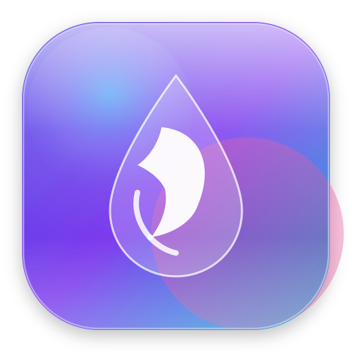

# 📄 Zen PDF — Universal Document Suite

<p align="center">
  
</p>

<p align="center">
  <b>A private, high-performance, 100% offline universal PDF & document suite designed for students, teachers, and professionals.</b>
</p>

<p align="center">
  
  
  
  
  
</p>

---

## 🌟 മലയാളത്തിൽ വിവരണം (Overview in Malayalam)

> **വിദ്യാർത്ഥികൾക്കും അധ്യാപകർക്കും ഓഫീസുകളിൽ ജോലി ചെയ്യുന്നവർക്കും ആവശ്യമായ എല്ലാവിധ ഡോക്യുമെന്റ് ടാസ്കുകളും iLovePDF-ലുമുള്ള എല്ലാ ടൂളുകളും അതിൽ കൂടുതലും ഒരൊറ്റ സ്ഥലത്ത് 100% സ്വകാര്യതയോടെ (Offline & Private) ചെയ്യാൻ സാധിക്കുന്ന ഒരു സമ്പൂർണ്ണ ഓൾ-ഇൻ-വൺ ഡോക്യുമെന്റ് സ്യൂട്ടാണ് Zen PDF.**
>
> സെർവറുകളിലേക്ക് ഫയലുകൾ അപ്‌ലോഡ് ചെയ്യാതെ പൂർണ്ണമായും നിങ്ങളുടെ കമ്പ്യൂട്ടറിലോ മൊബൈലിലോ തന്നെ പ്രോസസ്സ് ചെയ്യുന്നു. നേറ്റീവ് ആപ്പിൾ / ആൻഡ്രോയിഡ് ലിക്വിഡ് ഗ്ലാസ് ഡിസൈൻ, വാട്ടർ ഡ്രോപ്പ് റിപ്പിൾ ഇഫക്റ്റ്, ജിഗ്ഗ്‌ലി ഇലാസ്റ്റിക് ഫിസിക്സ്, മൃദുവായ ശബ്ദ ഫീഡ്‌ബാക്ക്, ക്ലീൻ ഡാർക്ക് മോഡ് / ലൈറ്റ് മോഡ്, ഇൻസ്റ്റാൾ ചെയ്യാനുള്ള നേറ്റീവ് വെബ് ആപ്പ് ടോഗിൾ എന്നിവയോട് കൂടിയാണ് ഇത് സജ്ജീകരിച്ചിരിക്കുന്നത്.

---

## ✨ Complete Tools Suite (44 ടൂളുകൾ & Apple Bento Studio)

Zen PDF ഇപ്പോൾ Apple VisionOS / iPadOS Bento Studio Layout-ൽ സജ്ജീകരിച്ചിരിക്കുന്നു. പ്രമുഖ വർക്ക്ഫ്ലോകൾക്ക് (Smart Vector Editor, Camera Scanner, Merge & Page Studio, Instant Compressor) പ്രത്യേക Bento കാർഡുകളും, ബാക്കി എല്ലാ ടൂളുകളും 7 കാറ്റഗറികളായി തരംതിരിച്ചിരിക്കുന്നു:

### 🗂️ 1. Organize PDF
- **Merge Documents**: Combine multiple PDFs into a single file in any desired order.
- **Split PDF**: Visual thumbnail page selector and range splitter (e.g. `1-3, 5, 8`).
- **Remove Pages**: Visual page deletion grid to remove unwanted, blank, or sensitive pages.
- **Extract Pages**: Extract selected pages into a brand new standalone PDF.
- **Organize PDF**: Visual interactive grid to sort, reorder, duplicate, delete and rotate pages.
- **Scan Document (Camera)**: Snap physical paper sheets using your camera/webcam and compile directly to PDF.

### ⚡ 2. Optimize PDF
- **Compress PDF**: Shrink bloated PDF files offline with multiple quality profiles (Balanced, Strong, Maximum).
- **Repair PDF**: Recover damaged or corrupted PDF streams, rebuild broken xref tables, and salvage valid pages.
- **OCR PDF (Text Scan)**: Convert scanned bitmap pages into selectable, searchable, and copyable text.
- **Grayscale PDF**: Convert color scans to crisp black-and-white for printer-friendly output.
- **Dark Mode Invert**: Invert page colors for comfortable night reading or saving printer toner.
- **Flatten PDF**: Lock form fields, annotations, and vector layers into immutable read-only pages.
- **Metadata & Privacy Scrub**: View properties and strip author, GPS, device, and software metadata in 1-click.

### 🔄 3. Convert to PDF
- **JPG / PNG to PDF**: Combine photos into standardized A4 or fit-to-image PDF documents.
- **Word to PDF**: Convert `.docx`, `.doc`, `.rtf`, or Markdown notes into structured PDF documents.
- **PowerPoint to PDF**: Create 16:9 modern presentation slide decks from text or lecture notes.
- **Excel / CSV to PDF Table**: Convert spreadsheets and CSV data into formatted, high-DPI PDF reports.
- **HTML to PDF**: Render HTML code snippets and web layouts directly into styled PDF pages.

### 🔁 4. Convert from PDF
- **PDF to Images (HD & ZIP)**: Render crisp 150/300 DPI images and download individually or as a single ZIP.
- **PDF to Word (.docx)**: Export formatted paragraphs and headings into a genuine editable `.docx` file offline.
- **PDF to PowerPoint (.pptx)**: Convert pages into presentation slide deck archive with standalone fullscreen presenter.
- **PDF Table to CSV / Excel**: Extract tabular column data into clean CSV spreadsheets.
- **PDF to PDF/A**: Conforms standard PDF to ISO 19005-1 (PDF/A-1b) archival standard with embedded sRGB profiles.
- **PDF to Markdown**: Convert documents into clean Markdown with headers and bullet lists for Obsidian & Notion.
- **Extract Text (TXT)**: Extract all readable text offline; copy to clipboard or export as `.txt`.

### ✍️ 5. Edit PDF & Forms
- **Smart PDF Editor**: Erase text, type vector replacements, draw freehand annotations, and insert shapes.
- **Rotate PDF**: Rotate individual pages (`90°`, `180°`, `270°`) or the whole document.
- **Crop & Trim Margins**: Trim white margins and scanner borders with live bounding-box preview.
- **Add Page Numbers**: Automated page numbering with positions (`Top/Bottom`, `Left/Center/Right`) and format options.
- **Add Watermark**: Stamp text watermarks with customizable rotation, opacity, font size, and color.
- **PDF Forms**: Fill interactive form fields, inspect form data, and export filled or flattened PDF.
- **Bates Numbering**: Sequential indexing (`DOC-000001`) for legal, corporate, and academic archives.

### 🛡️ 6. PDF Security
- **Unlock PDF**: Remove passwords and printing / copying permission restrictions permanently.
- **Protect PDF**: Encrypt your document with a secure password to prevent unauthorized access.
- **Sign PDF Studio**: Dedicated signature studio with smooth freehand drawing pad, calligraphy styles, and date badge.
- **Redact PDF**: Permanently blackout sensitive text, SSN, bank details, and confidential areas.
- **Compare PDFs (Diff)**: Side-by-side synchronized visual comparison between two PDF versions.

### 🧠 7. AI & Study Hub (Gemini AI & Offline)
- **Ask & Chat with PDF**: Conversational Q&A with any document, executive takeaways, and data extraction using Google Gemini AI.
- **AI Quiz & Study Suite**: Turn lecture notes and textbooks into 5-question interactive quizzes with automated grading, explanations, and 3D flipping flashcards.
- **AI Document Summarizer**: Dual-engine summarizer (Google Gemini AI Executive TL;DR & 100% offline extractive bullet takeaways).
- **Translate PDF**: Dual-engine translation (Gemini neural contextual translation into Malayalam, Hindi, Tamil, Spanish, French, German, Arabic + offline glossary).
- **PDF Audio Reader (TTS)**: Listen to documents read aloud page-by-page with speed and voice controls.
- **Certificate Generator**: Design print-ready student and employee award certificates with golden borders.
- **Compress Images**: Resize and compress JPG, PNG, and WebP images to save disk space with real-time size comparison.

---

## 🤖 Bring-Your-Own-Key (BYOK) Gemini AI Integration

- **Zero-Setup Privacy**: Zen PDF does not provide or mandate external keys. The application is 100% functional offline by default.
- **Bring Your Own Key**: Users can enter their free Google Gemini API key in **Settings (⚙️)** to unlock advanced conversational AI, deep quizzes, and multilingual neural translations.
- **Direct Client-to-API**: Keys and documents are stored solely in browser `localStorage` and sent directly to Google APIs over HTTPS. No middleware or backend server ever accesses your keys or files.

---

## 💧 Liquid Glass Interface & Physics

- **Liquid Glass Aesthetics**: Apple iOS 27 / modern Android translucent frosted glass with specular reflections that track pointer movement.
- **Water Ripple Canvas**: Interactive water drop wave simulation that reacts to pointer clicks and taps.
- **Sensory Audio**: Soft Web Audio synthesized water droplet acoustic feedback on button presses.
- **Jiggly Elastic Physics**: Tactile jelly spring animation on card clicks and interactive controls.
- **PWA Web App Switch**: An iOS-style pill switch in the header to install Zen PDF as a native desktop or mobile application.

---

## 🔒 100% Offline Architecture

1. **Zero External CSS / Build Dependencies**: Pure native CSS design system with light and dark mode tokens.
2. **Client-Side Execution**: All processing runs in local browser memory via `pdf-lib`, `pdf.js`, and `JSZip`.
3. **Complete Privacy**: Zero data leaves your computer or phone.

---

## 🚀 How to Run Locally

1. Clone or download this repository:
   ```bash
   git clone https://github.com/Shadow-wave/zen.git
   cd zen
   ```
2. Double-click `index.html` to open directly in any modern browser without any server or internet.

---

## 👨‍💻 Developer

**Aravind o k**
- **GitHub**: [@Shadow-wave](https://github.com/Shadow-wave)
- **Email**: [aravindok6@gmail.com](mailto:aravindok6@gmail.com)
- **Phone**: +91 6238 291 791

---

## 📄 License

MIT License — Copyright (c) 2026 Aravind o k.
